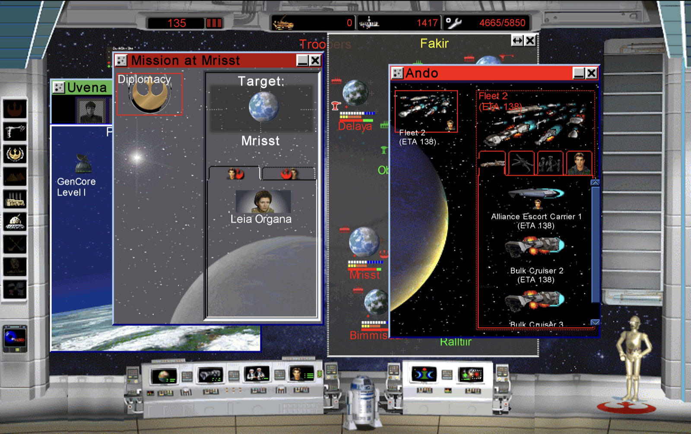
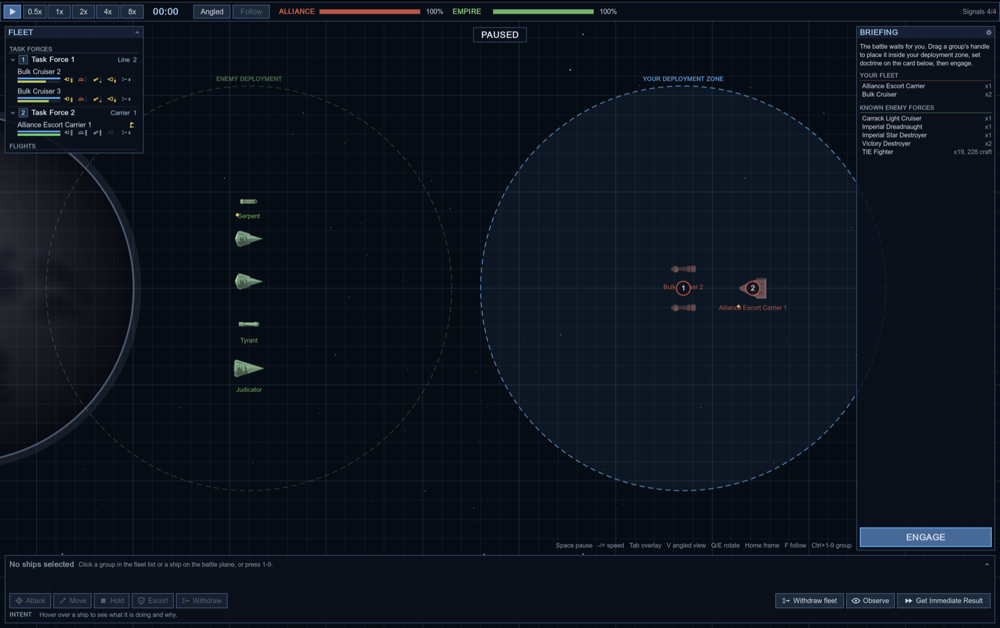

# Star Wars: Rebellion — native port

This is a port of the 1998 strategy game _Star Wars: Rebellion_ to Windows, macOS and Linux.
Claude/Codex decompiled it, modernized the code, fixed the crashes on Windows, and refactored it to add
cross-platform support for macOS and Linux.

The largest departure from the original is space combat. I didn't port the original 3D tactical mode, since
it was the most work and (IMO) the weakest part of the original game. It's been replaced with a
vibe-coded battle simulator and battle resolver, which fixes a number of bugs in the original resolver.

A few quality-of-life improvements:

- units in transit show their ETA after their name, without needing to menu-dive
- facilities show their ETA for finishing troops, buildings and ships
- **1**/**2**/**3**/**4** keyboard shortcuts for setting the speed
- a "repeat mission" button in the mission notification, letting you sabotage the next troop in the system or re-attempt a failed mission
- pressing **D** on the strategic screen opens a hidden developer menu (switch sides, choose AI controllers, disable these QoL changes).

There is also support for high-resolution displays and some HD artwork (the icons are the encyclopedia images with the background removed).

## Getting started

You'll need a copy of the original game (I tested with the Steam version):

- [Steam](https://store.steampowered.com/app/441550/STAR_WARS_Rebellion/)
- [GOG](https://www.gog.com/)

1. Clone this repo
2. Set the path to the original game in the config file (see [Configuration](#configuration))
3. Install the [prerequisites](#prerequisites)
4. `./create_build.sh && ./launch_game.sh`

### Prerequisites

Every platform needs **CMake** 3.20+, **Ninja**, **[uv](https://docs.astral.sh/uv/)** (runs the Python asset tools),
a **Clang** with C++23 support, and `curl`, `tar` and `sha256sum`. If you use [mise](https://mise.jdx.dev/),
`mise trust && mise install` provides CMake, Ninja and uv; run the scripts through `mise exec --` or with mise activated in your shell.

**macOS:** the Xcode command-line tools (`xcode-select --install`) provide Clang.

**Linux:** Clang 19 or newer with a C++23 standard library (GCC 13's libstdc++ or newer), plus the development headers
SDL needs for X11, Wayland and audio. On Debian/Ubuntu:

```sh
sudo apt install clang cmake ninja-build pkg-config \
  libx11-dev libxext-dev libxcursor-dev libxi-dev libxfixes-dev libxrandr-dev libxss-dev libxkbcommon-dev \
  libxtst-dev libxrender-dev libxcb1-dev libwayland-dev wayland-protocols libdecor-0-dev \
  libasound2-dev libpulse-dev libdrm-dev libgbm-dev libgl1-mesa-dev libegl1-mesa-dev libudev-dev libdbus-1-dev
```

Set `CC`/`CXX` when configuring if your Clang has a versioned name (`CC=clang-19 CXX=clang++-19 ./create_build.sh`).

## HD artwork (optional)

If `uv` is available, the first launch builds an HD artwork pack in `work/hd/gameplay-pack/` with upscaled galaxy
frames, backdrops and console buttons. Ship and character icons, planets and facilities can additionally be rebuilt
from your installation's encyclopedia pictures with one command:

```sh
uv run --locked --python 3.12 tools/build_encyclopedia_icons.py \
  --install-dir "orig_game_files/Star Wars - Rebellion" --no-overrides
```

This runs entirely locally; background removal downloads its model on first use. Run `./launch_game.sh --no-hd` to
play with the original artwork, or set `hd_asset_dir=` (empty) in the config to turn it off permanently. Details:
[docs/hd_artwork.md](docs/hd_artwork.md).

Space battles can also use ship sprites rendered with Blender ([docs/tactical_sprites.md](docs/tactical_sprites.md));
without them the battle view draws simple silhouettes. `--no-hd` turns these off as well.

## Configuration

The game reads `config.ini` from `~/Library/Application Support/Rebellion/` on macOS, `~/.config/rebellion/` on
Linux and `%APPDATA%\Rebellion\` on Windows (`$REBELLION_CONFIG` overrides). The only required key is the installation path:

```ini
install_dir=/path/to/Star Wars - Rebellion
```

## Screenshots




