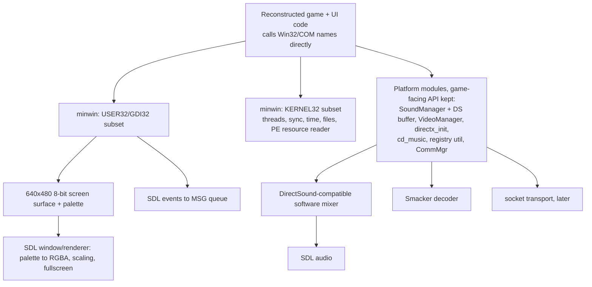

# Platform layer: how REBEXE.EXE uses Windows, and what the SDL port must provide

This document records how the game uses the Windows platform: windowing, rendering, resources, audio, video,
input, timing, files, the registry and multiplayer. It ends with a recommendation for the port's platform layer.
The full per-import table is in [`symbols/platform_usage.csv`](../symbols/platform_usage.csv)
(`dll,name,call_sites,modules,porting_note`). The 3D tactical presentation is out of scope and is mentioned only
briefly.

## Summary

- **The UI is a real Win32 window tree.** Every screen, panel, button, list and text field is its own `HWND`. All of
  them are created by one function (`0x5ffce0`, which calls `CreateWindowExA`), and they share one `WndProc`
  (`0x600310`). That `WndProc` forwards each message to the owning C++ object (`vtable+0x14`), MFC-style. Win32 does
  the hit-testing, focus, capture, clipping and paint scheduling. The "Cool" toolkit is a set of C++ window classes,
  not a self-drawn widget system.
- **There are no Win32 dialogs and no standard controls,** with one exception: the comctl32 tooltip. No `DialogBox*`
  or `CreateDialog*` is imported. The 6 `RT_DIALOG` templates in TEXTCOMM.DLL are never loaded. The "dialogs" are
  Cool windows drawn from bitmaps.
- **Drawing goes through GDI into a palettized 8-bit display.**
  - Artwork is held as 8-bit DIBs (resources, DIB sections) and composed by a software blitter (`0x5fcc30`, 84
    callers).
  - It reaches the screen through `BitBlt`/`SetDIBitsToDevice` in `WM_PAINT`.
  - Text is GDI `DrawTextA`/`TextOutA` in Arial.
- **DirectDraw creates no surfaces in the strategic game.** It only switches to 640×480×8 full-screen exclusive mode.
  Its `IDirectDraw2` is also handed to D3DRM for tactical.
- **The smallest faithful layer is an API-level Win32 subset (USER32/GDI32) implemented on SDL,** over one 640×480
  8-bit screen surface. Next to it:
  - small COM-compatible implementations of the few DirectSound/DirectDraw methods used;
  - a Smacker decoder behind the 15 SMACKW32 functions;
  - a PE resource reader that serves resources from the original DLLs;
  - a config store in place of the registry;
  - a later rewrite of CommMgr's DirectPlay transport.

  Rewriting only Cool's lowest layer is not enough: about 40% of the USER/GDI call sites (788 of 1952) are in the
  strategic UI code itself, not in Cool (see below).

## 1. Windowing and UI model

### Window classes and creation

- **Window creation.** `CreateWindowExA` has exactly two call sites:
  - `0x5ffce0`, the Cool window base, which has 72 callers and builds every game window;
  - `0x6008e0`, which creates the single `tooltips_class32` control.
- **Class registration.**
  - Classes are registered lazily in `0x5ffc80`: `GetClassInfoA` first, then `RegisterClassA` with style
    `CS_VREDRAW|CS_HREDRAW|CS_DBLCLKS`, `cbWndExtra = 4` and `lpfnWndProc = 0x600310`.
  - The `hInstance` is the resource DLL that supplies the artwork, so the trace shows `CoolStrobeButton` windows
    with `inst=04860000`, a loaded resource DLL rather than the EXE (which DLL was not checked).
  - The extra window slot holds the C++ `this`: `SetWindowLongA(hwnd, 0, this)` in `WM_CREATE`.

Game window classes. All are registered through `0x5ffc80`; all but `STARWARS_REBELLION` are named in calls to
the Cool window constructor `0x5ff910`:

| Class | Owner (module) |
|---|---|
| `STARWARS_REBELLION` | application main window (`RebellionApplication`, 0x413000) |
| `GAME_WINDOW_OBJECT` | generic game window (cool_window_base) |
| `CoolGameWindow` | full-screen game panels (galaxy view etc.) |
| `CoolStrobeButton` | bitmap buttons with blink animation |
| `CoolStringField`, `TextScrollField` | home-made edit fields (system caret, own text layout) |
| `CoolDragList`, `CoolSelectionBoxClass`, `CoolTabControl`, `CoolwinStatusBar`, `Scroll Bar`, `slider` | other Cool controls |
| `MOVIE_WINDOW`, `Smacker Window`, `Video Window` | video playback (movie_window 0x421300, VideoManager 0x5f6920) |
| `3D_WINDOW` | tactical 3D view (out of scope) |

**Window tree observed under Wine.** This comes from `WINEDEBUG=+win` on a menu-to-galaxy-view run
(`work/run/platform_explore3`):

- the top-level `STARWARS_REBELLION` window: style `0x86000000` (`WS_POPUP|WS_CLIPSIBLINGS|WS_CLIPCHILDREN`),
  640×480;
- `GAME_WINDOW_OBJECT` and `CoolGameWindow` children: style `0x46000000` (`WS_CHILD|WS_CLIPSIBLINGS|WS_CLIPCHILDREN`),
  640×480;
- about 30 `CoolStrobeButton` grandchildren at their artwork positions, for example `459,242 33x28` with id 0x73;
- `MOVIE_WINDOW` → `Smacker Window` (`WS_CHILD|WS_VISIBLE`) for the movies.

**Styles.** All static style constants are `WS_CHILD|WS_VISIBLE|WS_CLIPSIBLINGS|WS_CLIPCHILDREN`, sometimes with
`WS_TABSTOP` (0x56000000, 0x56010000, 0x52000000, 0x54000000, 0x50000000, 0x46000000). No `WS_CAPTION`, `WS_BORDER`
or `WS_THICKFRAME` was found, so **no non-client area exists**. `DefWindowProcA` never has to draw frames, and
there is no system move or size loop.

### Message flow

- **WinMain `0x4165b0`:**
  1. `CreateSemaphoreA("STARWARS_REBELLION")` acts as the single-instance guard.
  2. `0x60a910` checks the display: `GetSystemMetrics(SM_MOUSEPRESENT)`, then `CreateICA("DISPLAY")` +
     `GetDeviceCaps` for at least 640×480 and 256 colours.
  3. It does the CD/version check.
  4. It parses the command-line flags `-W` (0x1), `-N` (0x10) and `-L` (0x100); `-W` presumably means windowed,
     because app `+0x128 & 1` skips the display-mode switch.
  5. It builds the app (`0x413000`) and runs the loop `0x413560`.
- **Main loop `0x413560`** is a busy loop with no idle sleep:
  1. Drain the queue with `PeekMessageA(PM_REMOVE)`.
  2. For each message: app filter `vtable+0x24`, then `TranslateAcceleratorA` (accelerators from TEXTCOMM.DLL
     `RT_ACCELERATOR #11`, loaded at `0x421c70`), then `TranslateMessage`, then `DispatchMessageA`.
  3. When the queue is empty, step the game: `0x401bd0` → battle-flow/state machine `0x40a050`.
  4. Call the active screen's idle virtual (`+0x2c`).
  5. Handle multiplayer sync.
- **Nested modal loops**, which the platform layer must allow re-entrantly:
  - the galaxy view `WndProc` `0x422ce0` (around line 1195) runs its own `PeekMessage`/`GetMessage`/`Dispatch` loop
    *and keeps stepping the game* (`0x401bd0`) until a modal sub-window closes;
  - `CoolSelectionBox` `0x60c210` pumps messages while `GetAsyncKeyState(VK_LBUTTON)` or `GetCapture()` holds
    (drag);
  - the zoom-rectangle animation `0x428940` draws with `SleepEx(50)` between frames.
- **`WM_ACTIVATEAPP` drives start-up.** In `0x4138a0`, activation:
  1. sets the coop level and display mode;
  2. focuses the active screen;
  3. on first activation, loads TEXTCOMM/COMMON and starts the front-end state machine (`0x414330`).

  The shim must deliver `WM_ACTIVATEAPP(TRUE)` after the main window is created. Deactivation restores the
  display mode and minimizes the window.
- **Messages the UI code handles:**

  | Kind | Messages |
  |---|---|
  | lifecycle | `WM_CREATE`/`NCCREATE`, `DESTROY`/`NCDESTROY`, `SHOWWINDOW`, `GETMINMAXINFO`, `SIZING`, `CLOSE`, `QUIT` |
  | paint | `PAINT`, `ERASEBKGND` |
  | focus, cursor, activation | `SETFOCUS`/`KILLFOCUS`, `SETCURSOR`, `MOUSEACTIVATE`, `ACTIVATEAPP` |
  | keyboard | `KEYDOWN`/`UP`, `CHAR`, `SYSKEYDOWN`/`UP` |
  | mouse | `MOUSEMOVE`, `L`/`RBUTTON*` including double-click, `CAPTURECHANGED` |
  | commands, timers, scrolling | `COMMAND`, `SYSCOMMAND`, `TIMER`, `H`/`VSCROLL` |
  | palette | `QUERYNEWPALETTE`, `PALETTECHANGED` |
  | custom | about 23 custom `WM_USER+n` messages (0x401–0x483) |
- **Custom messaging is heavy.** There are 126 `PostMessageA` and 49 `SendMessageA` sites.
  - Controls notify their parents with *posted* `WM_COMMAND` (38 sites).
  - The game synthesizes input with `SendMessage(WM_KEYDOWN/WM_LBUTTONDOWN…)`.
  - Several custom messages carry **object pointers in `lParam`**. For example, `0x469` → `DestroyWindow(obj->hwnd)`
    followed by `delete obj` (`0x4138a0`).
- **Hooks** (`SetWindowsHookExA`, thread-local), which act as pre-dispatch filters:

  | Hook | Where | Purpose |
  |---|---|---|
  | `WH_GETMESSAGE` | `0x6008e0` | tooltip relay (`TTM_RELAYEVENT`) |
  | `WH_MOUSE` | `0x6010e0` | Cool capture/menus |
  | `WH_MOUSE` | `0x442c20` | closes the object pop-up menu on a click outside; uses `GetClassNameA` on the clicked window |
  | `WH_KEYBOARD` + `WH_MOUSE` | `0x41d9d0` | game UI facade: Escape-release and mouse handling → `0x43a200` |
- **Timers:**
  - `SetTimer`/`WM_TIMER`: 6 sites (scroll-bar auto-repeat, MultiPlayerWindow, pop-up menu).
  - Multimedia timers: `timeSetEvent` in a Cool timer class (`0x601f40`/`0x602060`, callback `0x6020d0`). The
    callback runs **on the winmm timer thread** and calls a virtual under a critical section. The strobe-button
    timer `0x603b90` → `0x4054a0` → `0x603a50` advances button animation frames and calls `InvalidateRect` *from
    that thread*. The sound stream class (`0x613ea0`) uses the same timer class.
- **Focus, capture, caret and cursor are all real Win32:**

  | Mechanism | Call sites |
  |---|---|
  | focus | `SetFocus` 99 |
  | capture | `GetCapture` 34; `SetCapture`/`ReleaseCapture` 3/24 (22 through wrapper `0x601090`) |
  | caret | caret APIs about 40, for CoolStringField/TextScrollField |
  | cursors | `LoadCursorA` 19, `SetCursor` 26, `ShowCursor` 10 (the app loops `ShowCursor(TRUE)` until the counter is ≥ 0) |

### Dialogs and standard controls

- **No Win32 dialog manager.** The game imports none of `DialogBox*`, `CreateDialog*`, `GetDlgItem` or
  `EndDialog`. There is no `FindResource` with `RT_DIALOG`.
  - TEXTCOMM.DLL holds 6 `RT_DIALOG` templates ("Quit The Rebellion", "Head To Head Play Setup", "Start a New
    Game", "Load a Saved Game", "Save the Current Game", "Start Game as Empire"). They appear to be unused
    leftovers.
  - REBDLOG.DLL, despite its name, contains only 24 bitmaps and 5 string blocks.
- **The game's own dialogs:** `CustomDialogBox` (`0x4ac120`) and the object windows are Cool child windows. They
  are made modal by the nested loop in `0x422ce0`.
- **Standard controls:** only `tooltips_class32`, which is why `InitCommonControls` is imported. The tooltip
  messages used are `TTM_ACTIVATE`, `TTM_SETDELAYTIME`, `TTM_ADDTOOLA`, `TTM_DELTOOLA` and `TTM_UPDATETIPTEXTA`
  (`0x600970`–`0x600db0`), plus the relay hook. There are no Edit, ListBox or ScrollBar controls; Cool replaces all
  of them.
- **`MessageBoxA`/`MessageBoxExA`** appear only on fatal paths: no CD, display too small, no mouse, and DirectX
  errors whose text comes from CDDERR.DLL (`0x614530`).
- **`WinHelpA("swhelp.hlp")`:** 2 sites.

### Painting

- **Who paints:** each window paints itself in `WM_PAINT`. There are 36 `BeginPaint` sites, 13 of them in tactical.
  - `CoolGameWindow` (`0x606650`) runs `BeginPaint` → `SelectPalette(g_palette)` → blit the background DIB
    (`0x607710` → `0x5fc140` with mode `'@'`, `SRCCOPY`) → overlay virtual `+0x44` → `EndPaint`.
  - Many windows also draw outside `WM_PAINT` with `GetDC`/`ReleaseDC` (88/93 sites).
- **What triggers paints:** state changes call `InvalidateRect` (177 sites, the most-used API), and Win32 delivers
  `WM_PAINT` later.
- **Off-screen composition:** windows build images in memory DCs: `CreateCompatibleDC` (30), `SelectObject` (192),
  a DIB section, then the software blitter or GDI text.
- **Clipping** comes only from the window system (`WS_CLIPCHILDREN`/`WS_CLIPSIBLINGS`). No region API is imported.

## 2. Rendering

### DirectDraw (`directx_init_errors`, 0x614000–0x6153b0)

- **Creation** (`0x614200`):
  1. `DirectDrawCreate(NULL)` stores the object at `0x6be6d8`.
  2. `QueryInterface(IID_IDirectDraw2)` stores the result at `0x6be6d4`.

  `DirectDrawEnumerateA` (callback `0x615220`, which searches for a `DDCAPS_3D` secondary adapter) is skipped
  because the app passes `param_2 = 1`.
- **Methods used** (Wine trace confirms):

  | Function | Method | Arguments / effect |
  |---|---|---|
  | `0x614310` | `IDirectDraw::SetCooperativeLevel` | `DDSCL_FULLSCREEN\|EXCLUSIVE\|ALLOWMODEX` (0x51) |
  | `0x6143a0` | `IDirectDraw2::SetDisplayMode` | 640, 480, 8 |
  | `0x614360` | `IDirectDraw2::SetCooperativeLevel` | `DDSCL_NORMAL`, *immediately after* the mode switch, so GDI owns the screen |
  | `0x615150` | `IDirectDraw2::EnumSurfaces` | callback `0x615130` → `IDirectDrawSurface::Restore` |
  | `0x615110` | `IDirectDraw2::RestoreDisplayMode` | |
  | `0x614290` | `Release` | |

  The sequence runs on `WM_ACTIVATEAPP` (`0x4138a0`). In windowed mode (`-W`), `0x614430` instead sizes the window
  with `AdjustWindowRectEx`/`SetWindowPos`.
- **No surfaces.** The four surface slots `0x6be6dc..0x6be6e8` are only zeroed and released, never created. The
  strategic game creates **no DirectDraw surfaces, palettes or clippers**.
- **Tactical** (out of scope):
  - reads `0x6be6d4` (`0x5d67ed`);
  - creates a clipper on `3D_WINDOW` (`0x5d6bb0`, `DirectDrawCreateClipper` + `SetHWnd`);
  - creates a D3DRM device from it (`0x5d6930`, the only `Direct3DRMCreate`).

  Its HUD/panels are ordinary Cool windows painted with GDI: 13 `BeginPaint` sites, 76 USER32 and 6 GDI32 call
  sites in all.

### GDI and the 8-bit pipeline (gfx `dib_bitmap_blit` 0x5fbd20–0x5fef50)

- **Bitmap class** (`0x5fbd20`, 95 callers): a `BITMAPINFO*` + bits.
  - Loaded from `RT_BITMAP` via `FindResourceA(hmod, id, 2)` (`0x5fc050`), or from a `.BMP` file with
    `_lopen`/`_lread` (`0x5fc530`; the EData encyclopedia images are plain BMP files).
  - The transparent colour key is the first pixel, decoded from RLE8 when needed (`0x5fd170`).
- **Off-screen buffers** (`0x5fbea0`, 34 callers): `CreateDIBSection(DIB_RGB_COLORS)` with the source's colour
  table.
- **Software blitter `0x5fcc30`** (84 callers): memory-to-memory 8-bit copies with colour-key transparency, plus an
  RLE path (`0x5fd1e0`). No GDI calls.
- **To-DC blit `0x5fc140`** (25 callers), selected by mode:
  - `'@'`: `CreateCompatibleDC` + `SelectObject(DIBSection)` (or `CreateDIBitmap` for non-section bitmaps) +
    `SelectPalette` + `BitBlt` with the caller's ROP;
  - other modes: `SetDIBitsToDevice`.
- **Palettes:**
  - `0x5fc3f0` builds a `LOGPALETTE` from a DIB's colour table.
  - `0x600010` turns it into an **identity palette**: it reads `GetDeviceCaps(NUMRESERVED)`, copies the 10+10
    static system colours from `GetSystemPaletteEntries` into the ends, marks the middle `PC_NOCOLLAPSE`,
    `SetSystemPaletteUse(SYSPAL_NOSTATIC → STATIC)`, `SelectPalette` + `RealizePalette`.
  - One global palette is current at a time (`0x6be5a0`/`0x6be4c0`). `WM_QUERYNEWPALETTE` re-realizes it.
  - There is no `AnimatePalette`. Palette changes happen on screen switches and in Smacker (`SmackBufferNewPalette`).
- **Primitives:**
  - `MoveToEx`/`LineTo`/`Polyline` (fleet window graphs);
  - `Rectangle`;
  - `PatBlt` (`BLACKNESS`, `PATCOPY`);
  - `SetROP2(R2_XORPEN)` for rubber-band rectangles;
  - `CreateSolidBrush` with `RGB()` and `PALETTERGB()` values.

  There is no `StretchBlt`; `SetStretchBltMode` is set but unused.
- **Text:**
  - Font table `0x6be4f8`, initialised in `0x5ff830`/`0x60eed0`: 14 `CreateFontIndirectA` slots, face **"Arial"**,
    heights 8–30 px, weights 400/700/900, `lfQuality = PROOF_QUALITY`.
  - Output: `DrawTextA` (22 sites; flags include `DT_CALCRECT|DT_SINGLELINE|DT_VCENTER|DT_NOPREFIX` and
    word-wrapped forms) and `TextOutA` (1).
  - Measurement: `GetTextExtentPoint32A` (14) and `GetTextMetricsA` (5), mostly in TextScrollField's own line
    layout.
  - Colour: `SetTextColor` takes `RGB`/`PALETTERGB` values.
  - Encyclopedia text contains tabs.

**How a frame reaches the screen.** The display is the GDI desktop in 640×480×8 mode (or a window with `-W`). A
state change calls `InvalidateRect`; Win32 later sends `WM_PAINT`. The window's paint code composes its 8-bit DIBs
with the software blitter and blits them with `BitBlt`/`SetDIBitsToDevice` into its own clipped area of the
screen. Text and lines are drawn directly with GDI through the realized identity palette. There is no back buffer
or page flip, and no frame pacing other than the busy main loop. Movies blit straight to their window's DC from a
playback thread (see §4).

## 3. Resources

**Loading path:**

- All resource DLLs are opened by `LoadLibraryA` in one place, the holder class `0x60ed60` (`resource_dll_fonts`).
- They are registered by **slot number** in `0x5ff020`, which tries the bare name first and then
  `<DllLocation>\name`. `0x5fefd0` maps a slot to its `HMODULE`.
- Resource references across the game are packed as `slot << 16 | id`, for example the `0x11000` in `0x4138a0`.
- Generic access is `FindResourceA` + `LoadResource` + `LockResource` (+ `FreeResource`), with 26–28 sites in 15
  modules.
- `LoadStringA` has only 4 sites: wrapper `0x60aa30` (`{u16 id, u16 slot}`), `0x601060`, and the CDDERR.DLL error
  strings.
- Strings from the EXE itself come from `RT_RCDATA` through `0x5f49e0`, e.g. `SAVEGAME\`, `SAVEGAME.00`,
  `NETGAME.00`.

| Slot | DLL | Contents (count; MB) |
|---:|---|---|
| 1 | TEXTCOMM.DLL | 9 `RT_STRING` blocks, 6 `RT_DIALOG` (unused), 1 `RT_ACCELERATOR` |
| 3 | TEXTTACT.DLL | 13 `RT_STRING` |
| 5 | ENCYBMAP.DLL | 31 `RT_STRING` |
| 6 | TACTICAL.DLL | 288 `RT_BITMAP`, 66 `WAVE`, custom **301** (87; DirectX `.x` meshes, `xof 0303bin`), custom **303** (397; tactical RLE textures named `*.BMP`), 2 cursors |
| 7 | STRATEGY.DLL | 1042 `RT_BITMAP` (20.7 MB), 66 `WAVE` (9.9 MB), 96 `RT_RCDATA` (26-byte records) |
| 8 | COMMON.DLL | 321 `RT_BITMAP`, 5 `WAVE` |
| 10 | GOKRES.DLL | 580 `RT_BITMAP` |
| 12 | REBDLOG.DLL | 24 `RT_BITMAP`, 5 `RT_STRING` |
| 14 (?) | ALSPRITE / EMSPRITE (per side) | about 215 `WAVE` (14–15 MB), 1640/2348 custom **302**, about 750 `RT_RCDATA` (frame-id lists), about 36 `RT_BITMAP` |
| ? | ALBRIEF / EMBRIEF | about 2700 custom **302**, about 20 `WAVE`, about 400 `RT_RCDATA` |
| ? | TEXTSTRA.DLL | 153 `RT_STRING`, 511 `RT_RCDATA` (player-message templates with `\|` + binary field codes); its version resource is checked for MP compatibility |
| ? | ENCYTEXT.DLL | 348 `RT_RCDATA` (encyclopedia text) |
| ? | VOICEFXA / VOICEFXE.DLL | `WAVE` only (tactical voices) |
| – | CDDERR.DLL | 10 `RT_STRING` (DirectX error texts) |
| – | REBEXE.EXE | 61 `RT_RCDATA`, 3 cursors, 1 icon |

Slot 14 for the sprite DLLs is inferred from the `FUN_005ff020(…, pcVar4, 0xe)` call. The other slots come from
literal `0x5ff020` calls.

**Custom resource types:**

- **302** (`0x12e`, parsed by `0x41c6c0`):
  - Header: `u16 width, u16 height (=row count), u32 data_size, u8 flag, u16 ×4` (hotspot or bounding box?).
  - Then `height` × `u32` row offsets, then the pixel data.
  - This looks like a per-row RLE 8-bit sprite. It also serves pixel hit-tests (`0x41cb30`). The exact encoding has
    not been decoded yet.
- **301:** DirectX retained-mode `.x` files (tactical).
- **303** (`0x12f`): tactical textures, `u32 w, u32 h` + RLE data.
- **WAVE** (string type, `0x6ac954`): RIFF PCM, e.g. 11025 Hz mono 16-bit, played through DirectSound (`0x611890`).
- **RT_RCDATA (10):** small binary records (sprite sequences, `u16 count + u16 ids`) and text.

Other data files are read by path, not as resources:

- GData `*.DAT`/`*.FDT`/`*.SPT` (CRT/iostream);
- EData `EDATA.nnn` (BMP, via `_lopen`);
- MDATA: `MDATA.000–2xx` are **Smacker** (`SMK2`), `MDATA.3xx` are RIFF WAV music;
- `data0.reb` (XOR 0xdd-obfuscated version/CD info, `0x406600`);
- saves under `SaveGame\`.

## 4. Audio, video, input, timing, files, registry, multiplayer

### Audio: DirectSound (SoundManager 0x610b20–0x611e90, buffer class 0x612bd0–0x614000)

- **Initialisation** (`0x610d00`):
  1. `DirectSoundCreate` into `g_directSound` (`0x6be668`).
  2. `SetCooperativeLevel(hwnd, DSSCL_EXCLUSIVE=3)`.
  3. Primary buffer (`0x611330`/`0x610e30`): `CreateSoundBuffer(primary)`, `SetFormat` (packed format such as
     `0x2b110110`, which encodes 11025 Hz), `Play(LOOPING)` to keep it running, and
     `QueryInterface(IID_IDirectSound3DListener)` (stored at `0x6be670`; only released, never used).

  **SoundManager init is called per screen** with that screen's `HWND` (the device is created only while `g_directSound` is NULL; `0x610dd0` releases it when the use count drops). Through `0x610be0` it is called by the
  front-end window (`0x405050`), the galaxy view (`0x422ce0`, twice) and tactical (`0x59ab40`); a use counter is at
  `0x6be678`.

  The callers pass flags 1 or 0x11. The optional branches of `0x610d00` are therefore never taken:
  - CD-audio open (0x10000);
  - the alternative primary format (0x100000);
  - Smacker sharing the game's device (0x1000).

  The Wine trace agrees: 8 `DirectSoundCreate` calls and no MCI activity in one run.
- **Secondary buffers.** Created by the buffer class in `0x612bd0–0x614000`, through `0x611140`/`0x6111b0`. That
  range is labelled `worker_threads` in modules.csv, but it is a DirectSound buffer and streaming class.
  - Methods used: `CreateSoundBuffer`, `DuplicateSoundBuffer`, `Lock`/`Unlock`, `Play`, `Stop`,
    `SetCurrentPosition`, `GetCurrentPosition`, `GetStatus`, `SetVolume`, `GetVolume`, `Restore`, `Release`.
  - Effect sounds come from `WAVE` resources.
  - Music (`MDATA.3xx`) is **streamed**:
    1. `IDirectSoundNotify::SetNotificationPositions` at the half-buffer marks (`0x613d10`);
    2. a refill thread waits on 3 events (`0x6136b0`, `WaitForMultipleObjects`).
- **Sound-event thread** (`0x611bf0` → `0x6119f0`): drains a completion queue and calls a game callback registered
  by `0x610c20`. That callback, `0x417780`, starts the next music track, so **game code runs on the sound thread**.
- **Smacker audio:** VideoManager calls `SmackSoundUseDirectSound(0)` (`0x5f70e0`), so Smacker creates its own
  DirectSound object for movie audio. The sharing path `0x611dc0` (`SmackSoundUseDirectSound(g_directSound)`) is
  behind the unused 0x1000 flag.
- **Not used:** no MIDI, no DirectSound3D buffers.

The Wine trace for a menu → galaxy run counts the method calls: `Lock` 704, `GetCurrentPosition` 504, `GetStatus`
284, `Unlock` 267, `CreateSoundBuffer` 27 (154 internal), `SetVolume` 42, `Play` 19, `SetNotificationPositions` 12.

### Video: SMACKW32 + MCI (VideoManager 0x5f6920–0x5f79b0)

- **Smacker movies:**
  1. `SmackOpen(path, 0xfe000 = all audio tracks)`.
  2. `SmackBufferOpen(hwnd, 3, w, h, …)` binds a RAD SmackBuf to the `Smacker Window`. The blit-type value 3 has not
     been looked up in smack.h.
  3. Per frame (`0x5f7240`): `SmackWait`, `SmackBufferNewPalette`, `SmackDoFrame`, `SmackToBufferRect` dirty-rect
     loop, `SmackBufferBlit` to the window DC, `SmackNextFrame`, `SmackGoto` (loop).
- **Skipping:** `GetAsyncKeyState(VK_ESCAPE/VK_LBUTTON)` inside the frame function skips the movie.
- **Threading:** playback runs on a **dedicated thread** (`0x5f7020` → `CreateThread(0x5f73f0)`, which loops
  `0x5f7240`). That thread does `GetDC`/blit, and it is stopped with **`TerminateThread`** (`0x5f7190`, `0x5f7020`).
- **Struct access:** the game reads Smack/SmackBuf struct fields directly (`smk+4`/`+8` for width/height, SmackBuf
  `+0x10`/`+0x14`/`+0x448`, first byte).
- **AVI path:** `AVIFileOpenA`/`AVIFileInfoA`/`AVIFileRelease` (`0x5f7940`) plus MCI `"avivideo"`
  (open/window/put/play/status/close, `0x5f7730`/`0x5f75a0`). No `.avi` file ships, so this path is probably dead
  (unverified).
- **CD audio:**
  - `cd_music` (`0x611e90`) opens MCI device type `MCI_DEVTYPE_CD_AUDIO` and sets `MCI_FORMAT_TMSF`; it also has
    status (`0x611fe0`), stop and close.
  - Nothing ever sends `MCI_PLAY` to it.
  - It is reached only through flag 0x10000 of `0x610d00`, which no caller passes, so it is effectively dead code.
  - No MCI activity appeared in the Wine trace.

### Input

- **Mouse and keyboard** arrive only as window messages through the Win32 tree (§1).
- **Polling:**
  - `GetAsyncKeyState`: 5 sites (movie skip, drag loops, button auto-repeat).
  - `GetKeyState`: 8 sites (Shift/Ctrl modifiers).
  - `GetCursorPos`: 8; `GetMessagePos`: 3.
  - Hit-testing: `WindowFromPoint`, `ChildWindowFromPointEx`.
- **Not used:** DirectInput, joystick, raw input.
- **Accelerators:** the TEXTCOMM accelerator table maps keys to `WM_COMMAND` 3001–3031. The app turns
  3001–3031 into message `0x483` for the active screen.

### Timing

- **`Stopwatch` (`0x5fbb20`, util `timer`):**
  - `QueryPerformanceFrequency`/`Counter`, with a fallback to `timeGetTime`.
  - It stores `1.0f / (float)freq.LowPart`, a quirk to keep.
  - `0x5fbbe0` returns elapsed seconds as x87 `float10`.
  - The app owns one at `+0x110`, which the game clock uses. Tactical has more.
- **`timeGetTime`:** 41 sites (CommMgr and MP window 20, tactical turn sync 14, UI animations 4).
- **`GetTickCount`:** 3. `Sleep`/`SleepEx`: front-end and zoom animations.
- **Multimedia timers:** see §1. The game loop itself is not timer-driven: it runs on every idle pass of the
  busy loop.

### Files

- **Most I/O goes through the statically linked CRT and the old iostream library:** `fopen` (e.g. `data0.reb`),
  `ifstream`/`ofstream` saves (`0x5f4a60`/`0x5f4b10`). These reach `CreateFileA`/`ReadFile`/`WriteFile` only inside
  LIBCMT.
- **Direct Win32 calls:**
  - `_lopen`/`_lread`/`_lclose` for BMP files (`0x5fc530`);
  - `FindFirstFileA` + `GetDriveTypeA` to check that `<InstalledLocation>\MDATA\MDATA.000` exists on a fixed drive
    (`0x416950`);
  - `DeleteFileA` (save delete, `0x5f4bd0`);
  - `GetFileVersionInfo*`/`VerQueryValueA`/`VerLanguageNameA` on TEXTSTRA.DLL (`0x406850`, MP version match).
- **Paths** are built from registry strings with backslashes and drive letters.

### Registry

- **Location:** everything is under `HKLM\SOFTWARE\LucasArts Entertainment Company LLC\Star Wars Rebellion`
  (helpers `0x5f3fc0` read string, `0x5f41b0` read DWORD, `0x5f4250` write DWORD).
- **Reads:**
  - `DataLocation`, `DllLocation`, `InstalledLocation`, `TooBigLocation`, `EncyLocation` (paths; `0x401440–0x401760`,
    `0x416820`, `0x45f7b0`);
  - `MismatchOpts`, `DisplayOpts`, `Volume`;
  - `MusicVolume`, `MusicSwitch`.
- **Writes:** `Volume`, `DisplayOpts`, `MusicVolume`, `MusicSwitch`.
- **Not registry values:** the network-simulation knobs in `0x413000` (`MinimumReceiveLatency`, `DropSendPercent`,
  `UseWaitForSingleObject`, …) are registered as named settings in a list (`0x5f4520`).
- **Not used:** `HKCU` (the helper understands the root names, but only `HKLM` is used).

### Multiplayer: DirectPlay (CommMgr 0x5f7cc0–0x5fa720)

- **Start-up:** `DirectPlayLobbyCreateA` → `IDirectPlayLobby::GetConnectionSettings` (called even in single-player:
  Wine logs `DPLAYX_GetConnectionSettingsA`), `SetConnectionSettings`, `Connect` (`0x5fa5e0`).
- **Interface:** `DirectPlayCreate` + `QueryInterface(IID_IDirectPlay3A)` (GUID `133efe41-…`; the name is from
  memory); `DirectPlayEnumerateA` lists service providers.
- **`IDirectPlay3A` methods used (from vtable offsets):** `Close`, `CreatePlayer`, `DestroyPlayer`, `EnumPlayers`,
  `EnumSessions`, `GetSessionDesc`, `Open`, `Receive`, `Send`, `SetSessionDesc`, `Release`.
- **Other platform calls:**
  - `CreateEventA` for receive events;
  - `timeGetTime`/`GetTickCount` for timeouts;
  - `GetUserNameA`/`GetComputerNameA` for default names;
  - `PostMessageA` (7) to notify the UI.

## 5. Import inventory

Call sites were counted by resolving every reference to each IAT slot in Ghidra.

- `mov reg,[IAT]` followed by `call reg` counts each `call reg`.
- `jmp [IAT]` import thunks (`0x615350–0x6153a4`) are replaced by their callers.
- `ReleaseCapture`'s wrapper `0x601090` is replaced by its 22 callers.
- Modules come from `symbols/modules.csv`; `crt` means ≥ 0x618a70.

| DLL | Imports | Used by game code | Game call sites (tactical) | Notes |
|---|---:|---:|---:|---|
| USER32 | 92 | 92 | 1380 (76) | 394 non-tactical functions. Subsystems: ui_strategic 788 and ui_framework 786 (USER+GDI combined), app 145, tactical 82, gfx 42, multiplayer 37, video 34, encyclopedia 24 |
| GDI32 | 40 | 40 | 572 (6) | 123 non-tactical functions |
| KERNEL32 | 106 | 39 | 203 | 67 are CRT-only (195 CRT sites). Game uses: resources (4 APIs, 106 sites), threads and sync (13), files (6), time (4), misc |
| WINMM | 8 | 8 | 64 | `timeGetTime` 41, MCI 17, MM timers 6 |
| SMACKW32 | 15 | 15 | 23 | VideoManager and SoundManager only |
| ADVAPI32 | 5 | 5 | 12 | registry (`registry_file_util`), `GetUserNameA` |
| VERSION | 3 | 3 | 4 | MP version check (`VerLanguageNameA` is a KERNEL32 import) |
| DDRAW | 3 | 3 | 4 | creation only (`0x614200`, `0x61524c`, tactical clipper) |
| DSOUND | 1 | 1 | 1 | `0x610d00` |
| DPLAYX | 3 | 3 | 3 | CommMgr |
| AVIFIL32 | 3 | 3 | 3 | VideoManager (dead path?) |
| COMCTL32 | 1 | 1 | 1 | `InitCommonControls` (tooltips) |
| D3DRM | 1 | 1 | 1 | tactical only |

Most-used APIs:

- **USER32:** `InvalidateRect` 177, `PostMessageA` 126, `SetFocus` 99, `ReleaseDC` 93, `GetDC` 88, `SetRect` 78,
  `SendMessageA` 49, `SetWindowPos` 42, `BeginPaint` 36, `EndPaint` 34, `GetCapture` 34, `DestroyWindow` 31.
- **GDI32:** `SelectObject` 192, `SelectPalette` 79, `GetStockObject` 40, `DeleteDC` 31, `CreateCompatibleDC` 30,
  `DeleteObject` 24, `SetTextColor` 23, `Rectangle` 16, `GetTextExtentPoint32A` 14, `SetBkMode` 14.

The only USER32 API used *only* by tactical is `GetCursor`.

### COM interfaces and methods called through vtables

| Interface | Methods used (vtable offset) | Where |
|---|---|---|
| `IDirectDraw` | QueryInterface (0), Release (8), GetCaps (0x2c, enum callback only), SetCooperativeLevel (0x50) | 0x614200–0x615300 |
| `IDirectDraw2` | Release, EnumSurfaces (0x24), RestoreDisplayMode (0x4c), SetCooperativeLevel (0x50), SetDisplayMode (0x54) | same |
| `IDirectDrawSurface` | Restore (0x6c), in the EnumSurfaces callback 0x615130 | same |
| `IDirectDrawClipper` | SetHWnd (0x20) | tactical 0x5d6bb0 |
| `IDirectSound` | Release (8), CreateSoundBuffer (0xc), DuplicateSoundBuffer (0x14), SetCooperativeLevel (0x18) | SoundManager |
| `IDirectSoundBuffer` | QueryInterface, Release, GetCurrentPosition (0x10), GetVolume (0x18), GetStatus (0x24), Lock (0x2c), Play (0x30), SetCurrentPosition (0x34), SetFormat (0x38), SetVolume (0x3c), Stop (0x48), Unlock (0x4c), Restore (0x50) | SoundManager, buffer class 0x612bd0–0x614000 |
| `IDirectSoundNotify` | SetNotificationPositions (0xc) | 0x613d10 |
| `IDirectSound3DListener` | Release only | 0x610f70 |
| `IDirectPlayLobbyA` | Connect (0xc), GetConnectionSettings (0x20), SetConnectionSettings (0x30), Release | CommMgr 0x5fa5e0 |
| `IDirectPlay3A` | QueryInterface, Release, Close (0x10), CreatePlayer (0x18), DestroyPlayer (0x24), EnumPlayers (0x30), EnumSessions (0x34), GetSessionDesc (0x58), Open (0x60), Receive (0x64), Send (0x68), SetSessionDesc (0x7c) | CommMgr |
| `IDirect3DRM*` | many (out of scope) | tactical presentation |

## 6. Recommendation: the port's platform layer

### Options considered

1. **Rewrite Cool's lowest layer against SDL** and keep Win32 out of the rest. Rejected.
   - Win32 is not confined to Cool. The strategic UI (`ui_strategic`, 36 modules) makes 788 USER/GDI calls itself,
     about as many as `ui_framework` (786).
   - The app shell, encyclopedia, multiplayer window and video add more.
   - The UI code depends on Win32 semantics: posted `WM_COMMAND` from child windows, `WS_CLIPCHILDREN` clipping,
     capture, focus, hooks, lazy `WM_PAINT`, and nested modal loops.

   Replacing Cool would mean rewriting most of the 350 KB of strategic UI, not porting it.
2. **Wine/winelib.** Wine works for the hybrid phase. As a shipping dependency it is heavy, it does not suit a
   native macOS arm64 build, and it does not fix 64-bit.
3. **An API-level Win32 subset ("minwin") implemented natively on SDL.** Recommended. The reconstructed code keeps
   calling `InvalidateRect`, `GetDC`, `BitBlt`… exactly as the original does. The same source then builds against
   `<windows.h>` in the hybrid and against minwin in the port.

### Recommended architecture

**USER32/GDI32 subset ("minwin")**

- **Size:** 91 USER32 and 40 GDI32 functions. About 20 of them are trivial: rect helpers, no-ops,
  `GetSystemMetrics`/`GetDeviceCaps` constants. The rest rests on a handful of mechanisms:
  - **Window manager:**
    - window objects with class, style, parent and z-ordered children, plus `GWLP_USERDATA`-style slot 0;
    - visible-region computation for `WS_CLIPCHILDREN`/`WS_CLIPSIBLINGS` (rect lists are enough: everything is
      rectangular);
    - show/hide, enable, focus, capture, `WindowFromPoint`, coordinate mapping.
  - **Message queue with Win32 priorities:**
    - sent messages run synchronously and re-entrantly;
    - posted messages come next, then input, then `WM_PAINT` (generated from update rects only when the queue is
      empty), then `WM_TIMER`;
    - `PeekMessage`/`GetMessage` must work from nested loops;
    - hook chains (`WH_GETMESSAGE`, `WH_MOUSE`, `WH_KEYBOARD`) run as pre-dispatch filters;
    - accelerators come from the `RT_ACCELERATOR` resource;
    - `TranslateMessage` builds `WM_CHAR` from SDL text input.
  - **GDI on 8-bit surfaces:**
    - DCs (window or memory) with a clip-rect list and selected bitmap, pen, brush, font and palette;
    - DIB sections are plain 8-bit buffers;
    - `BitBlt` (`SRCCOPY` and the few ROPs seen), `PatBlt`, `SetDIBitsToDevice`, lines/polylines, `Rectangle`,
      `R2_XORPEN`;
    - colour matching of `RGB`/`PALETTERGB` to the current palette.
  - **Palette manager:**
    - `GetDeviceCaps` reports an `RC_PALETTE`, 8-bpp, 640×480 device with 20 reserved entries, so the game keeps
      its identity-palette code path;
    - `GetSystemPaletteEntries` must return the standard Windows 20 static colours, because the game copies them
      into entries 0–9 and 246–255.
  - **Text:**
    - an Arial-metric TrueType font (Liberation Sans, or a user-supplied `arial.ttf`) through FreeType/SDL_ttf;
    - rendered non-antialiased into the 8-bit target;
    - `DrawTextA` flag semantics (word break, single line, vcenter, calcrect, tabs);
    - `GetTextExtentPoint32A`/`GetTextMetricsA`.
  - **Small built-in pieces:** caret (blinking software caret), a tooltip window class for the 6 `TTM_*` messages
    used, cursors (parse `RT_CURSOR` from REBEXE/TACTICAL → `SDL_CreateColorCursor`), and `ShowCursor` counter
    semantics.
  - **Presentation:** each pump iteration converts the 8-bit screen surface through the current palette and
    presents it with `SDL_RenderSetLogicalSize(640,480)`, so scaling and full-screen are free. `-W` becomes
    "windowed". DirectDraw display-mode calls become this toggle.
- **KERNEL32 subset:**
  - about 39 functions, all others being CRT-internal and disappearing with the host libc;
  - a **portable PE resource reader** for `LoadLibraryA`/`FindResourceA`/`LoadResource`/`LockResource`/
    `LoadStringA`/`LoadAcceleratorsA`/`LoadCursorA`/`GetFileVersionInfo*`, reading the user's original DLLs
    directly, with no extraction step;
  - threads, events, critical sections and interlocked operations;
  - QPC and `timeGetTime` on SDL timers;
  - file existence/delete and `_lopen`, with **path translation**: backslashes, drive letters, case-insensitive
    lookup.
- **Registry (5 functions):** a small config store (INI/JSON in the user's config directory) seeded with the
  `*Location` paths.
- **WINMM:** `timeGetTime`; `timeSetEvent` as **main-loop-polled** timers; MCI and AVI as stubs that fail cleanly.
- **DirectX:** provide C++ classes with the same interface names, implementing only the methods in §5.
  - **DirectDraw:** 7 methods → SDL window-mode control.
  - **DirectSound:** about 18 methods across `IDirectSound`/`IDirectSoundBuffer`/`IDirectSoundNotify` → a software
    mixer on the SDL audio callback. It must handle circular buffers with `Lock`/`Unlock`, play cursors,
    notification events, volume in hundredths of dB, duplicate buffers and looping.

  This keeps the reconstructed SoundManager and buffer class faithful and verifiable in the hybrid against real
  DirectSound.
- **Smacker:**
  - implement the 15 `Smack*` functions on a decoder (libsmacker is LGPL-2.1, or write one: the format is
    documented and small);
  - expose the few struct fields the game reads, or replace those reads with accessors in the reconstructed
    VideoManager;
  - route audio into the mixer.
- **DirectPlay:** do not emulate `IDirectPlay3A` semantics. Treat CommMgr as a platform module and reimplement its
  transport over TCP/UDP (ENet or SDL_net), keeping its game-facing API: the comm2 wrappers `0x596fa0` and the
  packet classes. Compatibility with the original game on the wire is not achievable anyway. Multiplayer is last in
  the decompilation order.

**Estimated surface:** about 215 imported functions (about 175 non-trivial) plus about 40 COM methods. Of those,
about 135 are the USER/GDI subset, which is where most of the effort and risk lie. Tactical presentation would add
D3DRM (out of scope); its GDI-painted panels would reuse minwin.

### Risks (and mitigations)

1. **Window-manager semantics.** Behaviour depends on:
   - message order, for example `WM_CREATE` vs `WM_NCCREATE` (the `WndProc` binds `this` in `WM_CREATE` and
     ignores messages before it);
   - when `WM_PAINT`/`WM_TIMER` fire;
   - re-entrant `SendMessage`;
   - focus and activation messages, especially the `WM_ACTIVATEAPP` start-up trigger;
   - capture-changed and `ShowCursor` counters.

   Mitigation: record per-`HWND` message sequences of the original under Wine (`+message`/`+win`, or a hybrid
   `WndProc` logging hook), and diff them against minwin on the same scenario.
2. **Text layout.** TextScrollField wraps lines by measuring with `GetTextExtentPoint32A`. Different Arial metrics
   change line breaks and paging. Mitigation: use a metric-compatible font and add a test that compares extents for
   all game strings under Wine and under minwin.
3. **Colour matching.** `PALETTERGB` and nearest-colour selection must pick the same indices as GDI. The identity
   palette depends on the 20 static colours.
4. **Threads touching UI and game state:**
   - the multimedia timer thread calls `InvalidateRect` and button-state code;
   - the video thread does `GetDC`/blit;
   - the sound thread runs the music-advance callback `0x417780`;
   - `TerminateThread` stops the video and sound threads.

   minwin should be main-thread-only. Run MM-timer callbacks from the pump, run movie frames from the pump (or
   hand frames to the main thread), and replace `TerminateThread` with cooperative stop. These are deliberate,
   documented deviations.
5. **64-bit:**
   - `this` is stored in window slot 0 (`SetWindowLongA(h,0,this)`);
   - object pointers travel in `LPARAM`;
   - `HWND`/handles are fields at fixed offsets in game classes (e.g. `+0x18`);
   - timer IDs and `DWORD_PTR` callback data (`timeSetEvent`).
6. **Unaligned and packed resource data.** The 302 header has `u16` fields at odd offsets. That is fine on x86-64
   and on arm64 hardware, but it is UB in C++ if read through casts. Parse with `memcpy` helpers.
7. **Smacker.** The decoder is LGPL if libsmacker is used. Audio/video sync and palette changes mid-movie matter.
   The game pokes at struct internals.
8. **DirectSound streaming.** Music refills rely on notification timing and on `GetCurrentPosition` granularity.
   Volume is in hundredths of dB (`SetVolume(-n)` from the registry `Volume`/`MusicVolume`).
9. **Busy loop.** The original spins at 100% CPU. Adding `SDL_Delay(1)` when the queue is empty should not change
   game logic, because the game clock is the Stopwatch, but this needs verifying in a scenario.
10. **Dead or legacy paths** (AVI, CD-audio MCI, DirectDraw 3D-adapter enumeration, `WinHelp`) are stubbed. Confirm
    each one is unreachable with the shipped data before relying on that.

### Decisions to make early

1. **How reconstructed code calls the platform.**
   - Use plain Win32/COM names and types through one header, `src/platform/win32.h`, which includes
     `<windows.h>`/`<dsound.h>`/`<ddraw.h>` in the hybrid and the minwin headers in standalone/port builds.
   - Add no wrapper layer in game code: it would make the reconstruction less faithful and double the review work.
   - Gate it in CI: a reconstructed function may only use APIs listed in `symbols/platform_usage.csv`, so the minwin
     surface stays known.
2. **Write 64-bit-clean Win32 from day one; it costs nothing in the 32-bit hybrid.**
   - Use `LONG_PTR`/`WPARAM`/`LPARAM`/`DWORD_PTR`/`UINT_PTR` and `GetWindowLongPtrA`/`SetWindowLongPtrA` (macros for
     the 32-bit functions in the hybrid SDK).
   - Never cast pointers or handles to `int`.
   - Use `WNDPROC`/`HOOKPROC`/`LPTIMECALLBACK` typedefs for callbacks.
3. **Layout asserts.**
   - Apply `static_assert(sizeof/offsetof)` only for the original 32-bit layout (e.g. `#if REB_ORIGINAL_LAYOUT`).
   - The 64-bit build must not depend on offsets of classes containing `HWND`/`HDC`/pointers.
   - Resource and save parsing must be explicit, never `memcpy`-into-struct.
4. **Platform modules.** Agree that `directx_init_errors` (0x614000), SoundManager (0x610b20), the DS buffer class
   (0x612bd0), cd_music (0x611e90), VideoManager (0x5f6920), timer (0x5fbb20), registry_file_util (registry part),
   resource_dll_fonts (0x60ed60) and CommMgr (0x5f7cc0, plus comm_packets) are **boundary modules**:
   - decompile them to learn their game-facing contract;
   - reconstruct them faithfully where the hybrid can verify them (sound, video);
   - their internals may be replaced per backend, while their callers stay untouched.
5. **Threading policy.** minwin is single-threaded. Specify how the four game thread entry points run in the port
   (MM timer, video, sound event thread, DS stream thread) before reconstructing those modules, so the
   reconstructions isolate thread bodies into functions the port can call from the pump.
6. **Display model.** The canonical framebuffer is 640×480 8-bit with one global palette. All scaling happens at
   present time. Do not add a true-colour path in game code.
7. **Resources and paths.**
   - Read the original DLLs at runtime through the PE resource reader; `HMODULE` is an opaque handle to a parsed
     DLL, and the `slot<<16|id` scheme is kept.
   - All file-opening entry points (CRT `fopen`, iostream `open`, `_lopen`, `FindFirstFileA`, `DeleteFileA`) go
     through one path-translation function in the port. This affects how the CRT/iostream replacement of phase 2 is
     built.

## How this was produced (reproducible)

- **Call-site counts:** Ghidra references to every IAT slot in `symbols/imports.csv`, collected with a `tools/gq`
  script. Thunk and wrapper callers were resolved by hand (listed in §5). The module mapping comes from
  `symbols/modules.csv`.
- **Resource inventory:** `pefile` over `orig_game_files/Star Wars - Rebellion/*.DLL`.
- **Dynamic evidence:** two runs of the original game.
  - `tools/run_game.sh --orig` with `WINEDEBUG=+win,+class,+ddraw,+dsound,+mci,+dplay,+timer,+cursor,+caret`.
  - Run 1 (`work/run/platform_trace`) reaches the menu.
  - Run 2 (`work/run/platform_explore3`) goes from the menu to the galaxy view: click the Rebel button at 468,335,
    press Esc twice, then click in the galaxy.
- **Code references:** `work/decomp/<addr>.c` for the functions cited.
